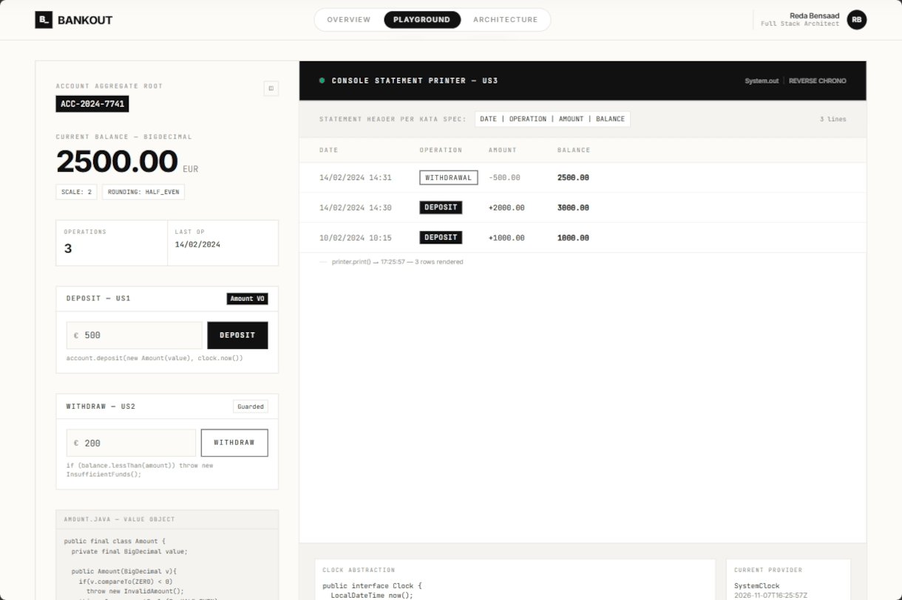

# Bankout

Pure Java implementation of the Bank Account Kata focused on software craftsmanship, domain modeling and test-driven development.

> \> [Live Preview](https://redabensaad.github.io/bankout)

---

$ Context

Bankout was developed as part of a technical assessment based on the Bank Account Kata.

The project intentionally avoids frameworks, persistence layers and user interfaces in order to focus exclusively on business logic, domain modeling and code quality.

---

$ What Was Built

> \> Deposit operations 
> \> Withdrawal operations 
> \> Account statement generation 
> \> In-memory account management 
> \> Financial calculations using BigDecimal 
> \> Business rule validation 
> \> Domain-specific exceptions 
> \> Statement printing layer 
> \> Clock abstraction for time control 
> \> Fully testable architecture 

---

$ Technical Stack

> \> Java 21 
> \> Maven 4 
> \> JUnit 5 
> \> AssertJ 

---

$ Architecture

The project follows a lightweight layered architecture separating domain logic, service orchestration and statement generation.

Business behavior is encapsulated within the domain layer while application services coordinate operations and statement rendering.

The design emphasizes immutability, explicit business rules and framework independence.

---

$ Design Decisions

The implementation evolved through multiple refactoring phases driven by TDD.

Particular attention was given to financial precision, temporal consistency and domain encapsulation through the introduction of dedicated value objects and a clock abstraction.

Additional technical details and rationale are documented in the `technical_choices.md` file.

---

$ Project Status

> \> Completed technical assessment 
> \> Live Preview available 
> \> Test-Driven Development approach 
> \> Framework-independent implementation 
> \> Maintained as a software craftsmanship reference project 

---

$ Notes

This project showcases pragmatic application of TDD, DDD concepts, clean architecture principles and maintainable testing practices within a small banking domain.

It was designed to demonstrate engineering decisions rather than infrastructure, frameworks or deployment concerns.

---

$ Preview

---

$ Built

✓ Feb 2024
